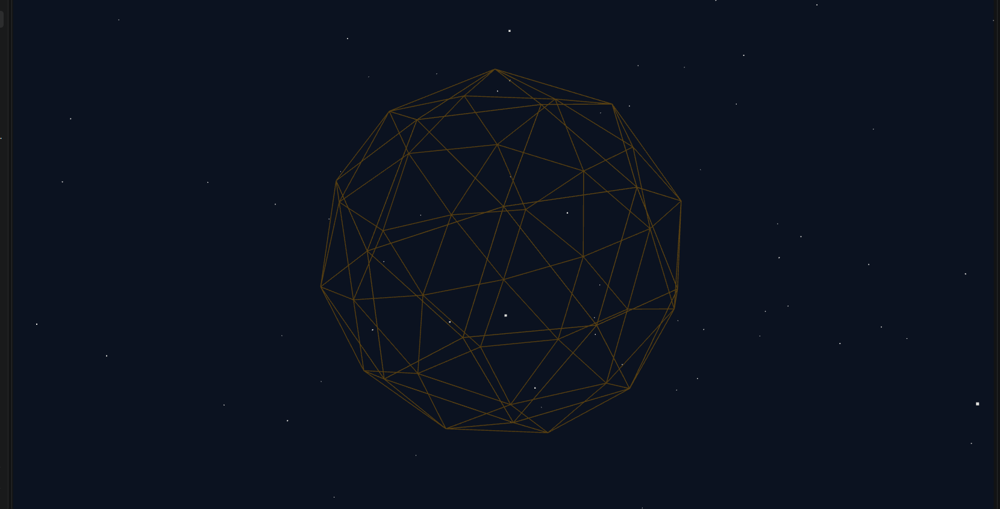

# 🌌 Project 3D

An interactive real-time 3D scene: a golden wireframe sphere floating in a starry sky, right in your browser.

---

## 📸 Preview

<p align="center">
  
</p>
---

## ✨ Features

- Real-time 3D rendering in the browser
- Animated wireframe sphere
- Starry background
- Instant hot reload in development thanks to Vite

## 🛠️ Tech Stack

- [React](https://react.dev/)
- [Vite](https://vitejs.dev/)
- [Three.js](https://threejs.org/)
- [ESLint](https://eslint.org/)

## 📁 Project Structure

```
project-3D/
├── 3d/
│   ├── public/            # Static files (images, icons...)
│   ├── src/               # Application source code
│   ├── index.html         # HTML entry point
│   ├── vite.config.js     # Vite configuration
│   ├── eslint.config.js   # ESLint configuration
│   └── package.json       # Dependencies and scripts
└── README.md
```

## 🚀 Getting Started

1. **Clone the repository**

   ```bash
   git clone https://github.com/rayanchakiboudineche-cell/project-3D.git
   cd project-3D/3d
   ```

2. **Install dependencies**

   ```bash
   npm install
   ```

3. **Start the development server**

   ```bash
   npm run dev
   ```

4. Open [http://localhost:5173](http://localhost:5173) in your browser.

## 📜 Available Scripts

| Command           | Description                         |
| ----------------- | ----------------------------------- |
| `npm run dev`     | Starts the development server       |
| `npm run build`   | Builds the production version       |
| `npm run preview` | Previews the production build       |
| `npm run lint`    | Checks the code with ESLint         |

## 🗺️ Roadmap

- [ ] Add mouse controls (rotate, zoom)
- [ ] Change the sphere color dynamically
- [ ] Add more 3D shapes
- [ ] Deploy the project online (Vercel / Netlify)

## 👤 Author

**chakib oudineche** — [GitHub](https://github.com/rayanchakiboudineche-cell)
